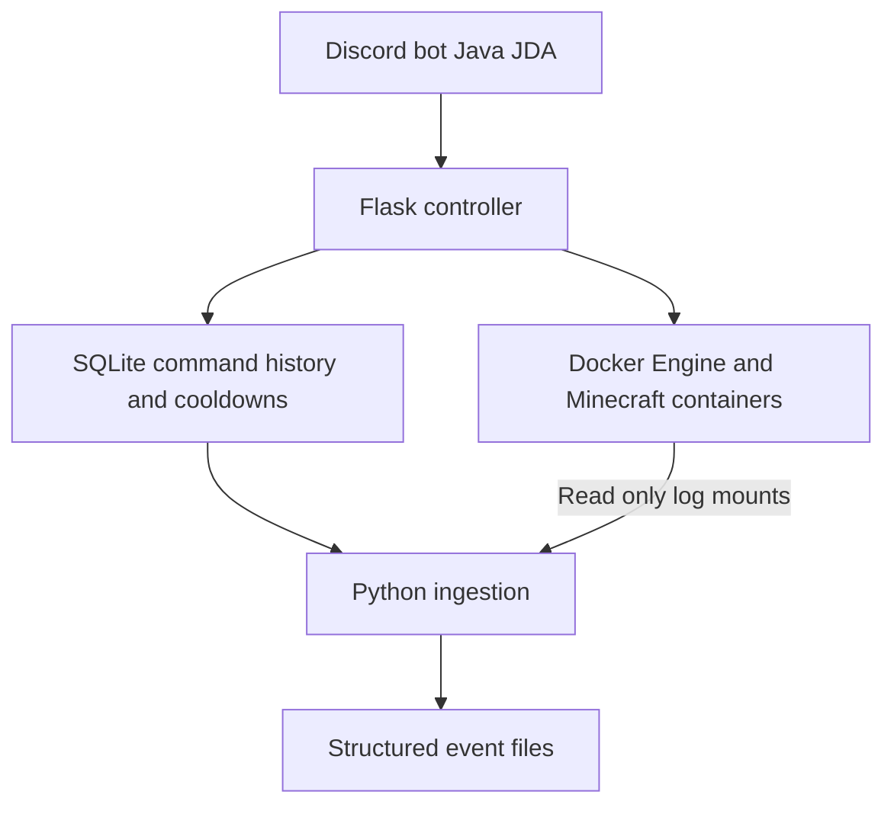

# Ubuntu Network Service Lab

## Explore the Project

### [Cybersecurity Skills & Code](CYBERSECURITY.md)
Role-based access, validation, audit logging, and event processing.

### [Database Skills & Code](DATABASE.md)
SQLite table definitions, parameterized queries, record updates, and incremental extraction.

**SQLite audit logging, parameterized SQL, and incremental data ingestion in a working service-management lab.**

I built this personal Ubuntu lab to manage Minecraft containers through a Java Discord bot and Python Flask API. Its database layer records command activity, persists cooldowns, and feeds a Python pipeline that exports structured events. The links below go directly to the relevant implementation.

## Database code at a glance

| What to review | Implementation | What it demonstrates |
| --- | --- | --- |
| Database structure | [Table definitions](https://github.com/AlexV4981/Ubuntu-network-service-lab/blob/3a3217b0114083f8a877651aa22680fd2b564d97/controller/app/controller.py#L35-L66) | Two SQLite tables, primary keys, NOT NULL constraints, and an automatically assigned history ID |
| Writing structured records | [Audit INSERT](https://github.com/AlexV4981/Ubuntu-network-service-lab/blob/3a3217b0114083f8a877651aa22680fd2b564d97/controller/app/controller.py#L67-L115) | Parameterized INSERT with seven bound values, a timestamp, and an explicit commit |
| Looking up existing records | [Cooldown SELECT](https://github.com/AlexV4981/Ubuntu-network-service-lab/blob/3a3217b0114083f8a877651aa22680fd2b564d97/controller/app/controller.py#L220-L262) | Parameterized SELECT with a WHERE condition, then a cooldown decision based on the stored expiry |
| Updating existing records | [Cooldown UPSERT](https://github.com/AlexV4981/Ubuntu-network-service-lab/blob/3a3217b0114083f8a877651aa22680fd2b564d97/controller/app/controller.py#L263-L296) | INSERT ... ON CONFLICT ... DO UPDATE to insert a command cooldown or update its existing expiry |
| Extracting new records | [Incremental SELECT and export](https://github.com/AlexV4981/Ubuntu-network-service-lab/blob/3a3217b0114083f8a877651aa22680fd2b564d97/ingest/parsers/controller.py#L62-L134) | Parameterized WHERE id > ?, explicit column selection, and ORDER BY id ASC |
| Preparing data for analysis | [Row-to-event mapping](https://github.com/AlexV4981/Ubuntu-network-service-lab/blob/3a3217b0114083f8a877651aa22680fd2b564d97/ingest/parsers/controller.py#L29-L61) | Mapping database fields into a consistent event format, writing JSON lines, and saving a processing checkpoint |

**Suggested review order:** table definitions → audit INSERT → cooldown UPSERT → incremental extraction. No running Discord account or game server is needed to read the database implementation.

## Database design

| Table | Key and constraints | Stored data and purpose |
| --- | --- | --- |
| `command_history` | `id INTEGER PRIMARY KEY AUTOINCREMENT`; all other fields are NOT NULL | Timestamp, user ID/name, command, result, prior state, and new state provide a record of handled activity |
| `cooldowns` | `command TEXT PRIMARY KEY`; `expires INTEGER NOT NULL` | One expiry per command, persisted between controller restarts |

These tables serve separate purposes and have no foreign-key relationship. Cooldowns are shared across users and configured servers for each command.

### Record writes and updates

The controller binds values separately from SQL text using SQLite's `?` placeholders. [Audit INSERT](https://github.com/AlexV4981/Ubuntu-network-service-lab/blob/3a3217b0114083f8a877651aa22680fd2b564d97/controller/app/controller.py#L67-L115) stores a command-history record; [Cooldown UPSERT](https://github.com/AlexV4981/Ubuntu-network-service-lab/blob/3a3217b0114083f8a877651aa22680fd2b564d97/controller/app/controller.py#L263-L296) handles the existing-record case with:

```sql
INSERT INTO cooldowns(command, expires)
VALUES (?, ?)
ON CONFLICT(command)
DO UPDATE SET expires=excluded.expires
```

The write functions call `conn.commit()` to persist their changes. The current implementation does not include an explicit rollback workflow or an atomic transaction spanning the Docker action, cooldown update, and audit write.

### From database rows to structured events

The [Incremental SELECT and export](https://github.com/AlexV4981/Ubuntu-network-service-lab/blob/3a3217b0114083f8a877651aa22680fd2b564d97/ingest/parsers/controller.py#L62-L134) reads records above the last saved ID in ascending order. It maps each row into an event containing `timestamp`, `source`, `event_type`, `actor`, `action`, `result`, and `metadata`, appends events to a JSON-lines file, then saves the final processed ID.

[View a synthetic controller event](examples/controller-event.json) · [View the common event builder](ingest/events.py)

The example contains fabricated identifiers. Runtime databases, actual log exports, and checkpoints are excluded from the current source tree.

## Scope and current limits

This project demonstrates **SQL/SQLite database structures, record insertion and updates, audit data, and incremental extraction**. Oracle/PLSQL and production data-correction scripts are not implemented.

The API records several successful and blocked actions, but not every failure or cooldown rejection. Export and checkpoint writes are separate operations, so crash recovery can replay records; replacing a database also requires checkpoint handling. More operational limitations and the setup instructions are below.

## Architecture



## Requirements

- A Linux Docker host with Docker Compose and access to `/var/run/docker.sock`.
- A Discord bot token, guild ID, and role ID for permitted operators. Invite the bot to that guild with bot and application-command scopes and permissions appropriate to its commands.
- Existing Minecraft containers named `mc-cobblemon` and/or `mc-horror`, with readable log directories. This repository does not provision those game servers.

The controller selects the most recently started running configured server. When none is running, `/up` attempts to start `mc-horror`. Change `SERVERS` and `DEFAULT_SERVER` in `controller/app/controller.py` to match a different setup.

## Setup

```bash
git clone https://github.com/AlexV4981/Ubuntu-network-service-lab.git
cd Ubuntu-network-service-lab
cp .env.example .env
```

Edit `.env` before starting:

| Variable | Purpose |
| --- | --- |
| `DISCORD_TOKEN` | Private bot token; never commit it |
| `DISCORD_GUILD_ID` | Guild where commands are registered |
| `MC_CONTROL_ROLE_ID` | Discord role allowed to run control commands |
| `UID` and `GID` | Linux user/group IDs for the bot container; obtain with `id -u` and `id -g` |
| `MC_COBBLEMON_LOG_DIR` | Host directory containing the Cobblemon server's `latest.log` |
| `MC_HORROR_LOG_DIR` | Host directory containing the Horror server's `latest.log` |

Set the log variables to your existing directories, preferably absolute paths. Defaults point to local example directories under `minecraft/`; they do not create or configure game servers. Existing installations using the old hardcoded host paths must set these variables before recreating containers.

```bash
docker compose config --quiet
docker compose up -d --build
docker compose logs -f helpy-bot minecraft-controller ingest
```

`docker compose config --quiet` validates configuration without printing the resolved bot token. The Java bot is built in a Maven Docker build stage; committed JARs and `target/` files are unnecessary.

## Commands

| Command | Behavior |
| --- | --- |
| `/ping` | Bot response check |
| `/status` | Active server status; controller limits requests |
| `/up` | Start the default server if no configured server is running |
| `/down` | Stop the active server |
| `/restart` | Restart the active server |

Control commands use a 180-second cooldown per command, shared across users and configured servers. The status limit is three requests per 60 seconds across the controller process.

## Data and ingestion

- `controller/data/controller.db`: runtime SQLite database with `command_history` and `cooldowns` tables.
- `ingest/processed/controller.json`: newline-delimited controller events selected by increasing database ID.
- `ingest/processed/minecraft.json`: newline-delimited Minecraft events containing source log lines.
- `ingest/state/`: local ingestion checkpoints, created at runtime.

Despite the `.json` suffix, each output line is an independent JSON object. The ingestion service polls every five seconds. Minecraft events currently wrap raw log lines rather than extracting detailed gameplay fields. Controller events map database fields to a common event structure.

Generated output, offsets, databases, and build files are ignored by Git. Keep runtime logs private: they can contain user identifiers, chat, addresses, and other operational details. A synthetic output example is available in `examples/controller-event.json`.

## Validation

1. Confirm the bot connects and `/ping` responds.
2. Confirm a user without the configured role cannot run control commands.
3. Use `/status` and a permitted control command; inspect the resulting `command_history` rows.
4. Confirm the ingestion output contains normalized controller events and Minecraft log events.
5. Restart ingestion and verify existing checkpoints prevent normal replay of previously processed records.

These are manual checks, not an automated test suite. A running Discord bot and Docker/Minecraft environment are needed for end-to-end validation.

## Current limitations

- This is a trusted-host lab. The controller mounts the host Docker socket, which grants powerful access to the Docker host. Do not expose the controller to untrusted networks.
- Discord role checks are enforced by the bot. The controller has no API authentication and trusts incoming user headers; another client with network access can bypass the bot's checks.
- Services share one Compose network; separate security tiers are planned, not implemented.
- The API records several successful and blocked actions, but not every failure or cooldown rejection. Audit records are not a complete security audit trail.
- Status limiting is process-local. State checks and cooldown operations are not atomic across concurrent requests.
- Controller ingestion assumes monotonically increasing database IDs. Checkpoints require care if the database is replaced. File-output writes and checkpoint updates are not one transaction, so crash recovery may replay events.
- Minecraft log rotation handling detects a saved offset larger than the current file, but is not a complete rotation/replacement strategy.
- Wazuh integration and alert rules are not implemented.

## Planned improvements

- Wazuh ingestion, alert rules, and dashboards.
- Controller authentication and narrower Docker permissions.
- Network segmentation and additional container hardening.
- More complete failure logging, ingestion recovery, and automated tests.
